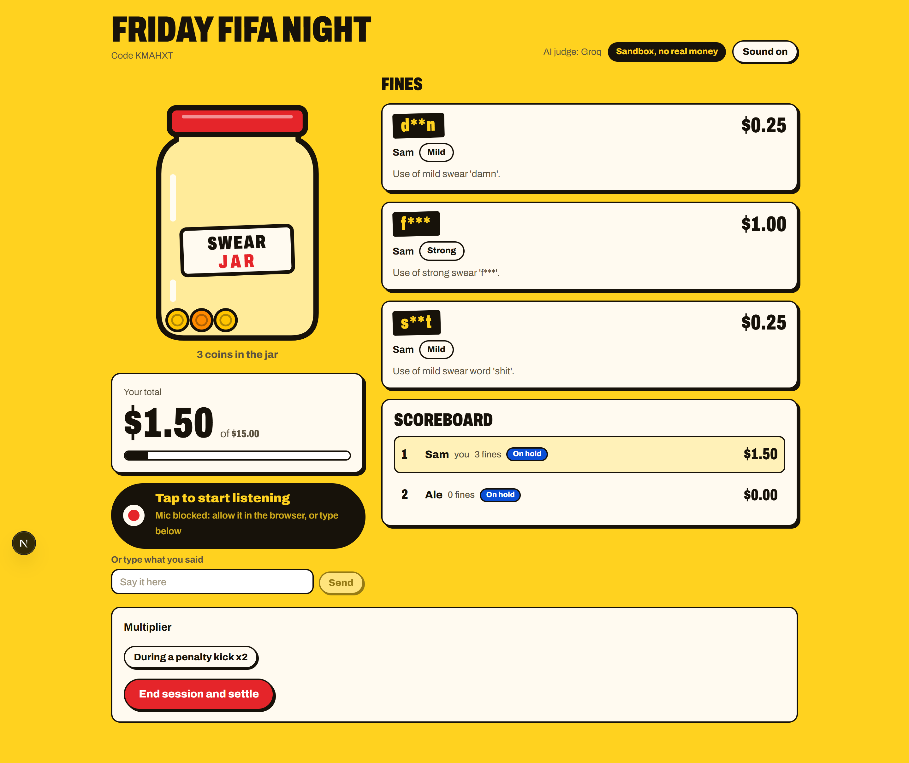
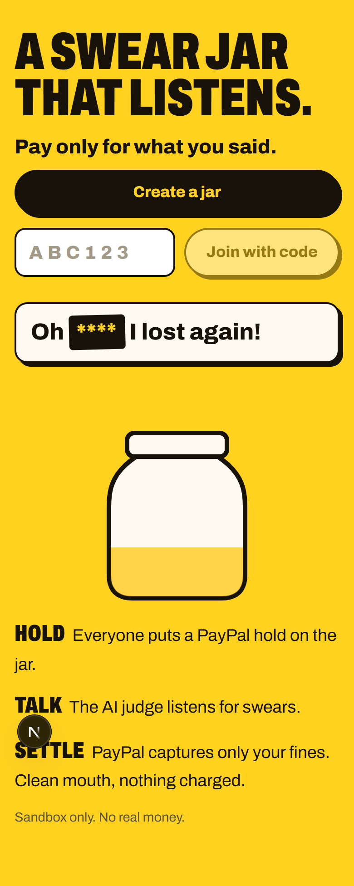
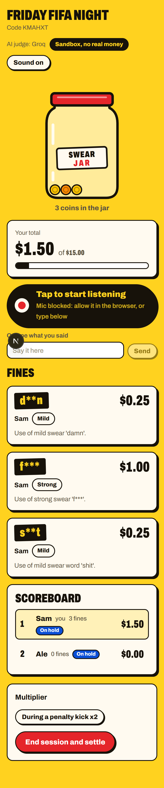
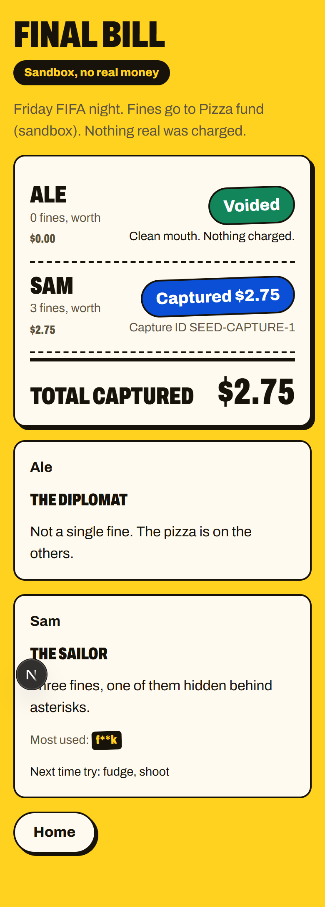
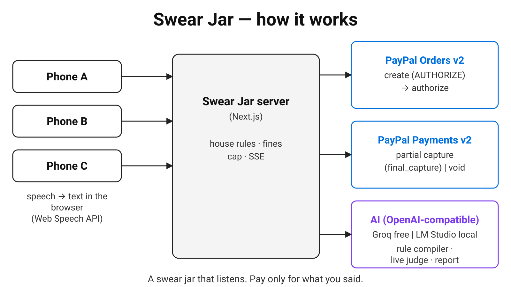

# Swear Jar

[](https://developer.paypal.com)
[](LICENSE)

A swear jar that listens. Put a PayPal hold on the jar, talk, and pay only for what you said.

**Live demo:** https://swearjar-4wsb.onrender.com (free Render instance: the first load can take about a minute)
**Video:** VIDEO_URL_HERE

Built for the [PayPal AI Hackathon](https://paypalaihackathon.devpost.com) 2026. **Sandbox only. No real money.**



| Home | Live | Final bill |
|---|---|---|
|  |  |  |



## How it works

1. **Hold.** Every player approves a PayPal authorization for the jar's cap (for example $10). Nothing is charged yet. A session cannot start until every player has an approved hold, and a player without a hold cannot be fined.
2. **Talk.** Each player's browser transcribes that player's own speech on that player's own device. The AI judge reads each sentence in context against the house rules the group wrote in plain language (for example: "blasphemy $2, swears 50 cents, 'damn' is free"). Fines appear in the jar live. Any player can object within 30 seconds.
3. **Settle.** When the session ends, PayPal captures exactly what each player owes from their own hold, never more than the cap. A player with no fines gets the hold voided. Settlement is idempotent, and a failed capture can be retried per player.

## How PayPal is used

The app uses PayPal's authorize, then capture or void, flow with Orders v2 and Payments v2. All PayPal calls run on the server.

| When | Call | Why |
|---|---|---|
| A player joins | `POST /v2/checkout/orders` with `intent: AUTHORIZE`, the cap as amount, the beneficiary as `payee` | Creates the hold order |
| The player approves | PayPal JS SDK buttons in the browser, then `POST /v2/checkout/orders/{id}/authorize` | Funds are held, not taken |
| Session ends, player has fines | `POST /v2/payments/authorizations/{id}/capture` with the fines total and `final_capture: true` | One capture for exactly what is owed. It is never above the hold, and the rest is released |
| Session ends, player is clean | `POST /v2/payments/authorizations/{id}/void` | Nothing charged |

Every write call sends a `PayPal-Request-Id` header. The key includes the order or authorization id, because a replayed key returns the old order. Money is integer cents everywhere in the code. The client secret stays on the server.

Public receipts (`/r/{id}`) show amounts and statuses only.

## How the AI decides

The AI classifies. Code decides the money.

- **Rule compiler.** The house rules become a validated price list. The jar creator reviews it as a table and confirms it before anyone can join. The AI never sets an amount.
- **Live judge.** One batched call about every 3 seconds covers the whole session. For each hit, the judge tells a swear from a mention of a word, and catches dodges such as asterisk-masked words and leetspeak. Each hit gets a confidence score. Code prices the hits from the approved rules and clamps the total to the player's cap. The AI never calls PayPal.
- **Report.** At the end, each player gets a short report.
- **Fallbacks.** With no AI key, the app runs in word-list mode, using a built-in list of about 85 English and Italian roots. If the AI is rate-limited or times out, that batch falls back to the word list and the screen shows "AI busy".

## AI providers

The app talks to any OpenAI-compatible endpoint, set only through environment variables. The hosted demo uses Groq's free tier with `openai/gpt-oss-20b` (judge) and `openai/gpt-oss-120b` (rules and report). LM Studio and Ollama should work through the same settings, but they are not tested in this build. Details in [docs/AI_PROVIDERS.md](docs/AI_PROVIDERS.md).

## Privacy

- The app does not record or upload audio. Speech is transcribed in the browser. Chrome and Edge send that audio to their speech service, which this app does not control.
- Only finished sentences reach the server. The server keeps the last three sentences per player in memory as judge context. Snapshots do not store that text.
- Fined words are shown as censor bars in the UI.
- Everyone in a jar can see everyone's fines. The join page says so.
- Receipts keep amounts, statuses and PayPal ids.

## Try it

**Hosted demo:** https://swearjar-4wsb.onrender.com

1. You need a PayPal sandbox buyer account (a personal account from the Developer Dashboard).
2. Use Chrome or Edge with a microphone. On other browsers, use type mode.
3. Create a jar. Leave the optional beneficiary email empty.
4. Open the join link, and approve the hold with the sandbox buyer account.
5. Start the session. With one player, the button reads "Start a solo test run".
6. To play a scripted conversation instead of speaking, add `?demo=1` to the session URL.

## Run it locally

Prerequisites: Node.js 20 or newer, and a PayPal developer account (free). A Groq key is optional. Without one, the app runs in word-list mode.

### PayPal sandbox setup

1. In the [PayPal Developer Dashboard](https://developer.paypal.com), open **Apps & Credentials** in sandbox mode. Create an app (REST API) and copy its client ID and secret.
2. Under **Sandbox accounts**, make sure you have:
   - two **personal** accounts, to act as buyers,
   - one **business** account, to act as the beneficiary.

### Steps

```
git clone https://github.com/therealthund3rr/swearjar.git
cd swearjar
npm install
cp .env.example .env     # fill in the PayPal keys and BENEFICIARY_EMAIL
npm run dev              # http://localhost:3000
```

Optional AI: set `AI_API_KEY` for Groq, or point `AI_BASE_URL` at another OpenAI-compatible endpoint. See `.env.example`.

Then create a jar, open the join link in a second browser profile, and approve the hold with a sandbox buyer account.

Scripts:

| Command | What it does |
|---|---|
| `npm run dev` | Development server on port 3000 |
| `npm run build` / `npm start` | Production build and server |
| `npm run lint` / `npm run typecheck` | ESLint and TypeScript |
| `npm test` | Unit tests (vitest) |
| `npm run shots` | Screenshots of each screen into `docs/media/screens/`. Needs `npm run dev` running and a local Google Chrome |

A Postman collection of the API is in [`postman/`](postman/). The API contract is in [docs/API.md](docs/API.md).

## Deploy

`render.yaml` defines a single Node web service on [Render](https://render.com) (free plan), with health check `/api/health`. Set the secret variables in the Render dashboard: `PAYPAL_CLIENT_ID`, `PAYPAL_CLIENT_SECRET`, `NEXT_PUBLIC_PAYPAL_CLIENT_ID`, `BENEFICIARY_EMAIL`, `BENEFICIARY_NAME`, `AI_API_KEY` and `APP_URL`.

The free disk is ephemeral and the instance sleeps when idle. Sessions do not survive a redeploy.

## Tests

`npm test` runs 71 unit tests in 7 files: money, lexicon, fines, judge queue, AI parsing, PayPal calls, and settlement.

## Project layout

```
src/app/          pages (home, new jar, join, live session, end, receipt) and API routes
src/components/   jar animation (GSAP coin drop), fine cards, PayPal hold button, scoreboard, mic button
src/lib/          pure logic: money, lexicon, rules schema, fines, demo script, i18n, env
src/lib/client/   browser side: API calls, player id, speech recognition, session hook
src/server/       PayPal client, settlement, AI calls, judge queue, in-memory store
tests/            vitest unit tests
scripts/          screenshot script (npm run shots)
postman/          API collection
docs/             API, design, decisions, AI providers, Devpost text, media
```

## What works

Built in one day for the hackathon. Working today:

- Creating a jar with house rules in plain language. The AI compiles them into a rule table that the creator confirms.
- A PayPal sandbox hold per player: an `AUTHORIZE` order, approval with the JS SDK, then the authorization.
- A live session with speech recognition in Chrome or Edge, or type mode, judged by the AI or by the word list.
- A partial capture of the exact fines at the end, and a void for clean players.
- Objections: any player can object within 30 seconds. Other players vote keep or drop within 20 seconds. Low-confidence fines start contested.
- Cross-talk guard: the same word from two players within 3 seconds fines only the earliest.
- A creator multiplier toggle, when the rules define one.
- A solo test run with one player.
- Recognition kept working with the Chrome tab hidden behind a full-screen game on Windows 11.
- A public receipt page and an end-of-session report per player.
- One light, English-only theme.

## Known limits

- Speech recognition works in Chrome and Edge, in English (en-US) only. Other browsers need type mode.
- One device per player. There is no speaker separation.
- The judge was checked on a small set of sentences and is not benchmarked. LM Studio and Ollama are not tested in this build.
- Sessions live in memory on one instance, with JSON snapshots. They do not survive a redeploy.
- No login. Each browser keeps its player id in localStorage. Someone holding a copied id can post utterances and votes in that jar, but cannot move money beyond holds that player approved.
- Family mode (a parent's hold covering sponsored players) exists in the engine and the API, but is hidden in the UI. See Roadmap.
- The word list is small (about 85 roots). Lexicon mode misses most context.
- Sandbox only. Live PayPal would need a review of the payee model, fees and terms.

## Roadmap

Nothing here is a promise.

- Family mode in the UI: sponsored players with no PayPal account, and a cleaner word on each fine card. The engine support exists.
- Other UI languages and speech recognition languages. The app is English only now.
- A shareable PNG card, an Open Graph image and a hero GIF.
- Webhooks for capture status instead of direct calls.
- Server-side speech transcription (Whisper).
- Discord posting of fines.
- An evaluation set for the judge, and `npm run eval:judge`.

## Contributing

Issues and pull requests are welcome. Read [CONTRIBUTING.md](CONTRIBUTING.md) first. Please be kind: see the [Code of Conduct](CODE_OF_CONDUCT.md). Security problems go through [SECURITY.md](SECURITY.md).

## License

MIT, see [LICENSE](LICENSE).

## Credits

Swear Jar is made by THUND3RR.

- [PayPal REST APIs](https://developer.paypal.com/api/rest/) (Orders v2, Payments v2) and the [PayPal JS SDK](https://developer.paypal.com/sdk/js/), sandbox environment.
- Open models served by [Groq](https://groq.com) (free tier): `gpt-oss-20b` and `gpt-oss-120b`.
- [Next.js](https://nextjs.org), [Tailwind CSS](https://tailwindcss.com), [zod](https://zod.dev), [GSAP](https://gsap.com) and the other dependencies in `package.json`.
- Hosted on [Render](https://render.com).
